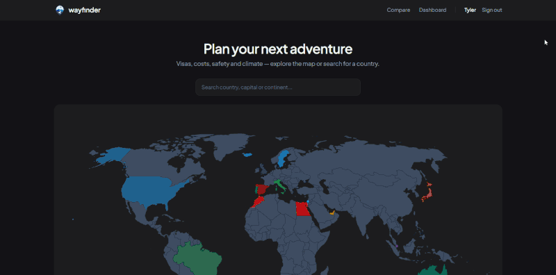
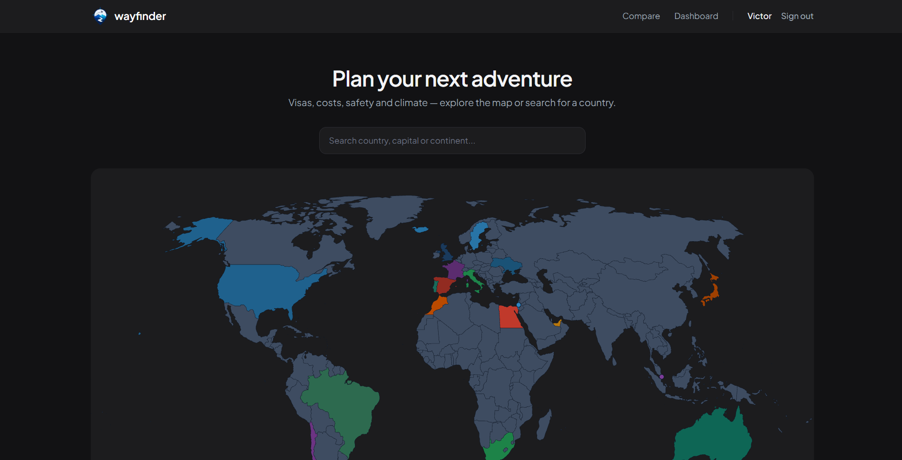
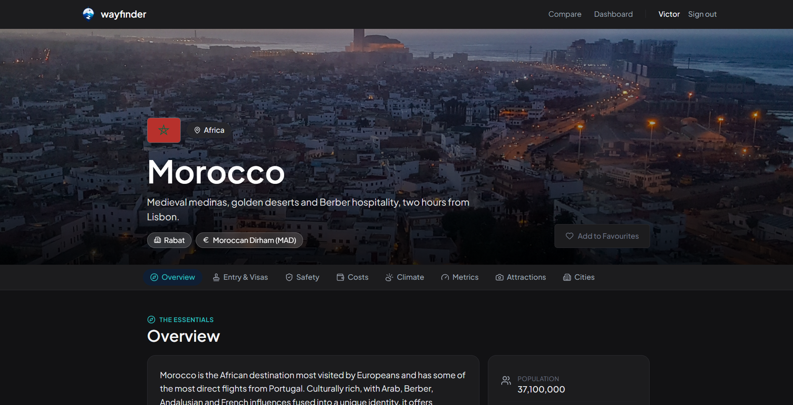
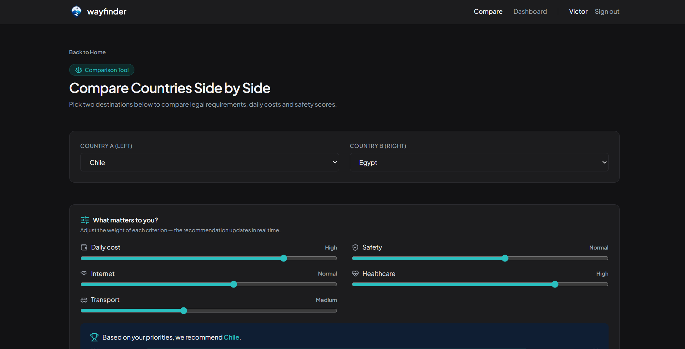
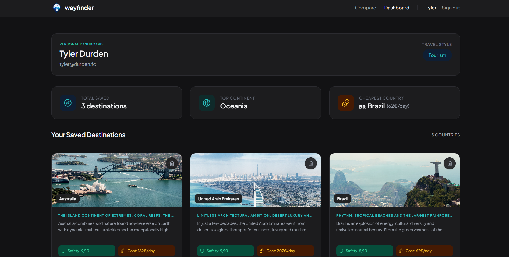

# WayFinder



### Explore. Plan. Go.

[](https://github.com/MarcondezVictor/wayfinder/actions/workflows/ci.yml)


Travel information is scattered across dozens of websites. **WayFinder** brings it all into one place — search by country, explore an interactive world map, and get a clear picture of visa requirements, daily costs, safety scores and climate before you book.

---

## Demo

🔗 **Live app:** _[deploy link coming soon — Vercel]_

---

## Screenshots

| Home | Country page |
|:---:|:---:|
|  |  |
| **Compare** | **Dashboard** |
|  |  |

---

## Features

- **Interactive world map** — click any highlighted country to jump straight to its detail page (powered by amCharts 5)
- **Smart search** — real-time dropdown searching by country name, capital or continent
- **Country page** — overview, entry & visas, safety, costs, climate, quality-of-life metrics, top attractions and major cities
- **Trip cost calculator** — estimate total spend by number of days
- **Country comparison** — compare two destinations side by side with a weighted scoring system and priority sliders
- **Personal dashboard** — saved destinations with statistics (most-visited continent, cheapest saved country)
- **Authentication** — sign up / sign in / password reset via Supabase Auth

---

## Tech Stack

| Layer | Technology |
|---|---|
| Framework | Next.js 16 (App Router) |
| Language | TypeScript 5 |
| Styling | Tailwind CSS v4 |
| Icons | Lucide React |
| Map | amCharts 5 + amCharts Geodata |
| Database & Auth | Supabase (PostgreSQL + Row Level Security) |
| Deployment | Vercel |

---

## Getting Started

### Prerequisites

- Node.js 18+
- A free [Supabase](https://supabase.com) account

### Clone & install

```bash
git clone https://github.com/MarcondezVictor/wayfinder.git
cd wayfinder
npm install
```

### Environment variables

Copy the example file and fill in your Supabase credentials:

```bash
cp .env.example .env.local
```

Open `.env.local` and set:

```env
NEXT_PUBLIC_SUPABASE_URL=https://your-project-id.supabase.co
NEXT_PUBLIC_SUPABASE_ANON_KEY=your-anon-key-here
NEXT_PUBLIC_SITE_URL=http://localhost:3000
```

Your Supabase URL and anon key are found in **Supabase Dashboard → Project Settings → API**.

### Run in development

```bash
npm run dev
```

Open [http://localhost:3000](http://localhost:3000).

### Production build

```bash
npm run build
npm start
```

---

## Project Structure

```
src/
├── app/
│   ├── page.tsx                  # Home (map + country grid)
│   ├── country/[slug]/           # Country detail page
│   ├── compare/                  # Side-by-side comparison tool
│   ├── dashboard/                # Personal saved-destinations dashboard
│   ├── login/                    # Sign in
│   ├── register/                 # Sign up
│   ├── forgot-password/          # Password reset request
│   └── reset-password/           # Set new password
├── components/
│   ├── AuthProvider.tsx          # Global auth context
│   ├── CountriesGrid.tsx         # Country grid with continent filter
│   ├── CountryFacts.tsx          # Extra facts from restcountries.com API
│   ├── FavoriteButton.tsx        # Save / unsave a destination
│   ├── InteractiveMap.tsx        # amCharts world map
│   ├── Navbar.tsx                # Main navigation
│   └── Searchbar.tsx             # Search dropdown
└── lib/
    ├── db-countries.ts           # Supabase queries with local fallback
    ├── countries-data.ts         # Local fallback dataset
    └── supabase.ts               # Supabase client
public/
├── covers/     # Country cover photos  (<iso2>.jpg, e.g. fr.jpg)
├── attractions/ # Attraction photos    (<iso2>-<n>.jpg, e.g. fr-1.jpg)
└── flags/      # SVG flags            (<iso2>.svg, e.g. fr.svg)
```

---

## Database

SQL migration files live in `supabase/`:

| File | Purpose |
|---|---|
| `supabase/setup.sql` | Creates all tables, RLS policies and the sign-up trigger |
| `supabase/seed.sql` | Inserts the 20 countries with all their data (safe to re-run) |
| `supabase/visa_update.sql` | Updates visa/passport/ETIAS data for all countries |
| `supabase/english_values.sql` | Converts older databases from Portuguese to English values (continents, travel styles) — not needed for fresh installs |

Run them in order in the **Supabase Dashboard → SQL Editor**.

### Schema overview

| Table | Description |
|---|---|
| `countries` | All country data (visas, costs, climate, attractions, …) |
| `profiles` | Public user profile (name, nationality) |
| `user_preferences` | Preferred travel style |
| `favorites` | User ↔ country saved relationship |

Row Level Security is enabled — each user only accesses their own rows in `profiles`, `user_preferences` and `favorites`.

---

## Roadmap

- [ ] Deploy to Vercel and add live link
- [ ] Add more countries to the dataset
- [ ] Mobile-optimised map experience
- [ ] AI-powered trip recommendations

---

## License

[MIT](LICENSE) © 2026 Victor Hugo Lopes

---

## Team

Built as the final group project for the Integrated Project I course at Polytechnic University of Tomar.

| Member | Role |
|---|---|
| **Victor Hugo** — [MarcondezVictor](https://github.com/MarcondezVictor) | Development (all code: frontend, backend, auth, integrations) |
| **Rodrigo Andrade** | Database design |
| **Eric Cardoso** — [ericcardoso938](https://github.com/ericcardoso938) | Research and country data |
| **Martim Marcelino** — [Maarcelino0](https://github.com/Maarcelino0) | UI design |

## My contributions

I wrote the entire codebase — every commit in this repository is mine:

- Next.js App Router architecture, all pages and components
- Supabase integration: authentication (sign up, sign in, password recovery), Row Level Security, queries with a local fallback dataset
- Interactive world map (amCharts 5), search, country comparison with weighted scoring, trip cost calculator, personal dashboard
- Dark/light mode and the redesigned UI, implemented from the team's design
